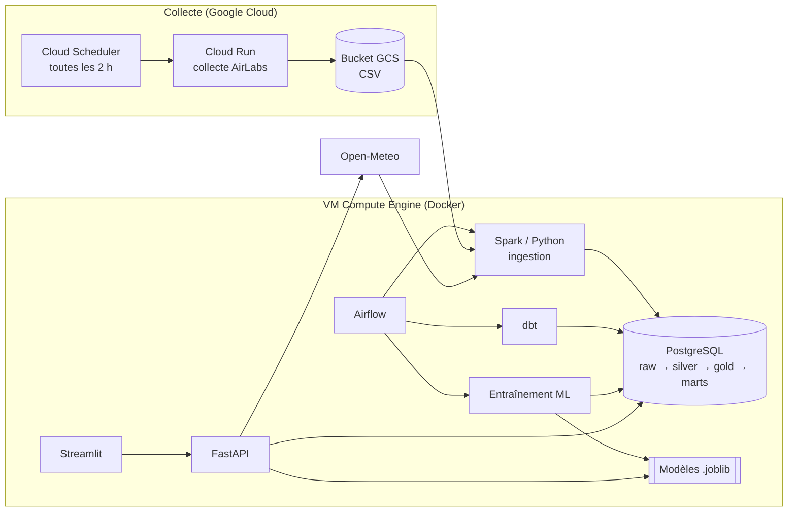

# Liora Airline — Prédiction des retards à l'arrivée à Paris

Projet fil rouge du cursus **Data Engineer** de DataScientest (promotion SEP26).

> **Va-t-il arriver à l'heure ?** On sait suivre un avion en temps réel, mais pas savoir, avant son départ, s'il arrivera à l'heure.
> Ce projet prédit si un vol à destination de **Roissy-CDG, Orly ou Beauvais** atterrira avec **plus de 15 minutes de retard** (définition Eurocontrol), uniquement à partir de **données gratuites, connues avant le vol** : aéroports, compagnie, horaire prévu, jour de la semaine et prévisions météo.

---

## Sommaire

- [Vue d'ensemble](#vue-densemble)
- [Architecture](#architecture)
- [Pipeline de données](#pipeline-de-données)
- [Orchestration](#orchestration)
- [Modèle ML](#modèle-ml)
- [API et interface](#api-et-interface)
- [Organisation du projet](#organisation-du-projet)
- [Démarrage en local](#démarrage-en-local)
- [CI/CD](#cicd)
- [Sécurité](#sécurité)
- [Limites et pistes d'amélioration](#limites-et-pistes-damélioration)
- [Notes](#notes)
- [Équipe](#équipe)

---

## Vue d'ensemble

| Élément | Description |
|---|---|
| Cible | Retard à l'arrivée > 15 min (binaire : oui / non) |
| Périmètre | Vols **atterris** à destination de CDG, ORY et BVA |
| Sources | [AirLabs API v9](https://airlabs.co) (vols, aéroports, compagnies) · [Open-Meteo](https://open-meteo.com) (archive météo horaire et prévisions à 16 jours) |
| Stockage | Bucket Google Cloud Storage (fichiers bruts) · PostgreSQL en architecture médaillon (raw / silver / gold / marts) |
| Traitements | Scripts Python / Spark (ingestion), dbt (transformations), scikit-learn et XGBoost (ML) |
| Orchestration | Cloud Scheduler (collecte) · Airflow (tout le reste) |
| Exposition | API FastAPI (clé d'API) · interface Streamlit (authentification Google) |
| Hébergement | Google Cloud : VM Compute Engine + Cloud Run |

---

## Architecture



**Google Cloud**
- **VM e2-standard-2** (2 vCPU, 8 Go) : héberge tous les conteneurs Docker. Elle est éteinte la nuit pour réduire les coûts.
- **Cloud Run + Cloud Scheduler** : la collecte AirLabs tourne hors de la VM, toutes les 2 h, nuit comprise.
- **Cloud Storage** : stockage des fichiers CSV collectés.
- **Secret Manager** : secrets lus via l'identité de la VM et du Cloud Run, sans clé.
- **Artifact Registry** : images Docker.
- L'infrastructure est décrite en **Terraform** dans [`infra/`](infra/README.md).

**Conteneurs sur la VM**

| Service | Rôle |
|---|---|
| `database` | PostgreSQL, un schéma par couche |
| `airflow-*` | Orchestration (scheduler, API server, DAG processor) |
| `spark` | Scripts d'ingestion et d'entraînement, lancés par Airflow |
| `dbt` | Transformations SQL, tests et documentation |
| `api` | API FastAPI de prédiction |
| `frontend` | Interface Streamlit |
| `jupyter` | Notebooks d'exploration et de test |
| `portainer` | Administration des conteneurs |

---

## Pipeline de données

Architecture **médaillon**, un schéma PostgreSQL par couche :

| Couche | Contenu | Exemples |
|---|---|---|
| **raw** (bronze) | Données brutes, chargées telles quelles depuis les API et fichiers | vols AirLabs, météo, référentiels |
| **silver** | Données nettoyées : UTC, doublons, valeurs nulles, codes corrigés | `stg_schedules`, `stg_weather_hourly`, `stg_airports`… |
| **gold** | Modèle en étoile | `fact_flights`, `fact_weather_hourly`, `dim_airports`, `dim_airlines`… |
| **marts** | Tables prêtes à l'usage | `mrt_ml_flights_features` (entraînement), `mrt_delay_by_*` (statistiques) |

### Collecte

- **Vols (AirLabs)** : l'offre gratuite est limitée à 1 000 requêtes par clé et par mois, et 50 lignes par appel. Le script [`src/airlabs_collect`](src/airlabs_collect) tourne donc toutes les 2 h sur Cloud Run, avec une **rotation de clés**, et dépose un CSV par aéroport et par passage dans le bucket.
- **Météo (Open-Meteo)** : 15 variables horaires par aéroport (vent, rafales, précipitations, neige, nuages, etc.). La collecte est **incrémentale** (seulement les jours manquants), **idempotente** (`ON CONFLICT DO NOTHING`) et s'arrête proprement au premier refus pour quota (HTTP 429).

### Qualité des données

Principaux problèmes corrigés dans le pipeline :
- **Fuseaux horaires** : un historique mêlait UTC et heure locale. Tout le pipeline travaille désormais en UTC.
- **Retard non renseigné** : un `arr_delayed` vide signifie « pas en retard ». Le traiter comme une valeur manquante faisait passer le taux de retard de 25 % à 51 %.
- **Codes aéroport ambigus** (ISB, TBS) : corrigés par un seed dbt `airport_corrections`.
- **Vols en partage de code** : une seule ligne est conservée par vol physique.

### Transformations (dbt)

`dbt seed` → `dbt run` → `dbt test` → `dbt docs`. Les tests portent sur l'unicité et la non-nullité des clés, les relations entre faits et dimensions, et la non-nullité de la cible. Chaque modèle est documenté dans un `schema.yml`, et le lignage est généré par `dbt docs`.

---

## Orchestration

| Déclencheur | Tâche | Fréquence |
|---|---|---|
| Cloud Scheduler | Collecte AirLabs (Cloud Run) | Toutes les 2 h |
| DAG `ingest_airlabs_schedule` | Chargement des CSV en raw, puis collecte météo | 8 h 30, 14 h 30, 20 h 30 UTC |
| DAG `airline_pipeline` | dbt seed / run / test / docs | 8 h 30 et 14 h 30 UTC |
| DAG `train_models_weekly` | Entraînement RandomForest + XGBoost | Vendredi 10 h UTC |

---

## Modèle ML

- **Données** : `marts.mrt_ml_flights_features`, une ligne par vol. Au 05/11/2026 : 57 599 vols, dont 22,7 % en retard.
- **Variables** : compagnie, aéroports de départ et d'arrivée (OneHot), jour de la semaine, heure d'arrivée prévue, 15 variables météo à l'arrivée et 15 au départ.
- **Pas de fuite de données** : seules les informations connues avant le vol sont utilisées. Le découpage train / test se fait **par jours entiers**, pour que des vols du même jour (même météo) ne se retrouvent pas des deux côtés.
- **Modèles** : RandomForest et XGBoost, avec pondération de la classe « retard ». Le prétraitement et le modèle sont enregistrés ensemble dans un pipeline scikit-learn.
- **Évaluation** : ROC AUC, précision, rappel, F1.
- **Résultat** : une AUC d'environ 0,6. La principale cause de retard, le retard de l'avion sur son vol précédent, n'est pas disponible au moment de la prédiction.

**Gestion des modèles.** Il n'y a pas de MLflow : chaque modèle est versionné (`xgb_AAAAMMJJ_HHMM.joblib`) et ses scores sont enregistrés dans `ml.model_runs`. La **mise en production reste une décision humaine** : on choisit le modèle actif depuis l'interface, et l'API le recharge sans redémarrage.

---

## API et interface

**API FastAPI** (protégée par l'en-tête `X-API-Key`, documentation Swagger sur `/docs`) :

| Route | Rôle |
|---|---|
| `POST /predict` | Prédiction de retard pour un vol, avec une probabilité |
| `POST /flights` | Recherche de vols (numéro, aéroports, compagnie, horaire) |
| `GET /airports`, `GET /airlines` | Référentiels |
| `GET /stats/{hour\|airline\|airport}` | Statistiques de retard |
| `GET /models` | Liste des modèles entraînés et de leurs scores |
| `POST /models/{model_name}/deploy` | Mise en ligne d'un modèle |

**Interface Streamlit** (connexion Google OAuth) :
- recherche d'un vol et prédiction, avec le niveau de confiance ;
- statistiques de retard par heure, compagnie et aéroport ;
- scores des modèles et choix du modèle actif ;
- tables de référence.

---

## Organisation du projet

Structure inspirée du template [cookiecutter data science](https://drivendata.github.io/cookiecutter-data-science/), adaptée au projet.

```
├── LICENSE
├── README.md
├── docker-compose.yaml        <- Services déployés sur la VM
├── docker-compose.dev.yaml    <- Surcharge pour le développement local (build + code monté)
│
├── .github/workflows
│   ├── build-push-docker.yml  <- CI/CD des conteneurs de la VM
│   └── deploy-airlabs.yml     <- CI/CD du Cloud Run de collecte AirLabs
│
├── docker                     <- Un Dockerfile par service
│   ├── collect                <- Collecte AirLabs (Cloud Run)
│   ├── postgres
│   │   ├── init               <- Initialisation de la base (schémas, utilisateurs)
│   │   └── migrations         <- Scripts de création et de migration des tables
│   ├── dbt, fastapi, streamlit, spark, jupyter
│
├── docs
│   └── DOCUMENTATION_TECHNIQUE.md
│
├── infra                      <- Terraform (VM, Cloud Run, Scheduler, réseau, secrets)
│
├── logs
│
├── references
│   └── data                   <- Référentiels à ingérer (aéroports, compagnies)
│
└── src
    ├── airflow/dags           <- DAGs : ingestion, dbt, entraînement
    ├── airlabs_collect        <- Collecte AirLabs (point d'entrée Cloud Run)
    ├── api                    <- API FastAPI
    ├── data                   <- Scripts d'exploration et de collecte ponctuels
    ├── dbt                    <- Projet dbt (models raw / silver / gold / marts, seeds, macros)
    ├── frontend               <- Interface Streamlit
    ├── spark
    │   └── notebooks
    │       ├── common         <- Librairies partagées
    │       ├── ingestion      <- Chargement des vols et collecte météo
    │       └── ml             <- Entraînement et déploiement des modèles
    └── visualization
```

---

## Démarrage en local

Prérequis : Docker et Docker Compose, plus un fichier `.env` contenant les variables nécessaires (mots de passe PostgreSQL, clé d'API, clés AirLabs, etc.).

```bash
# Construit les images en local et monte le code source
docker compose -f docker-compose.yaml -f docker-compose.dev.yaml up --build
```

| Service | URL |
|---|---|
| Airflow | http://localhost:8080 |
| Streamlit | http://localhost:8501 |
| Jupyter | http://localhost:8888 |

Tests :

```bash
cd src
pytest
```

---

## CI/CD

GitHub Actions est utilisé pour :

- **Tester** : lint `flake8` et tests `pytest`, qui bloquent le déploiement en cas d'échec.
  - Sur une **Pull Request** vers `master` : seulement les tests.
  - Sur un **merge dans `master`** : la chaîne complète ci-dessous.
- **Construire et pousser les conteneurs** dans Artifact Registry (`build-push-docker.yml`). Seuls les conteneurs dont quelque chose a changé sont reconstruits :
  - détection des services modifiés (code ou Dockerfile) ;
  - génération des images à partir des Dockerfile ;
  - envoi des images dans Artifact Registry, pour les utiliser lors du déploiement.
- **Déployer les images sur la VM** : connexion SSH, puis `git pull` et `docker compose`.
- **Mettre à jour le Cloud Run** de collecte AirLabs (`deploy-airlabs.yml`) : mêmes étapes, puis déploiement avec les outils Google.

> Nous aurions pu séparer les workflows (un par service), mais nous avons choisi un workflow intégré, plus complexe, pour explorer les possibilités de GitHub Actions.

---

## Sécurité

- **Aucun secret dans le code** : tout est dans GitHub Secrets (pour la CI/CD) et Google Secret Manager (pour l'exécution).
- **Accès à GCP depuis GitHub** par **Workload Identity Federation** : un jeton temporaire, sans clé de compte de service.
- **Déploiement sur la VM** par une clé SSH stockée dans GitHub Secrets.
- **API** protégée par une clé (`X-API-Key`) ; **interface** protégée par une authentification Google.

---

## Limites et pistes d'amélioration

- **Historique court** : les scores gagneront en stabilité avec la poursuite de la collecte.
- **Variable manquante** : le retard du vol précédent de l'avion, première cause de retard, n'est pas disponible gratuitement.
- **Vols de nuit** : pour un vol qui arrive le lendemain, la météo et le jour de la semaine sont pris la veille.
- **Code météo** : traité comme un nombre ; un traitement par catégories serait plus juste.
- **Liste des variables** : définie à trois endroits (dbt, entraînement, API) ; une liste partagée éviterait les écarts.
- **EuroAirport Bâle-Mulhouse** : 181 vols sans aéroport de départ. Une table d'alias reste à ajouter.
- **Déploiement sur la VM** : passer par `gcloud compute ssh --tunnel-through-iap`, pour se passer de la clé SSH et fermer le port 22.

---

## Notes

* `.dockerignore` : évite d'embarquer l'historique Git et les autres fichiers inutiles dans les images.
* `.gitattributes` : force les fins de ligne Linux (LF), sinon les scripts `.sh` risquent de planter au démarrage des conteneurs.
* Les versions de scikit-learn (1.7.2) et de XGBoost (3.2.0) doivent être identiques dans les conteneurs Spark et API.

---

## Équipe

- Pascal LAMERENS
- Hervé CYR

Mentor : Nicolas FRADIN

Documentation détaillée : [docs/DOCUMENTATION_TECHNIQUE.md](docs/DOCUMENTATION_TECHNIQUE.md)
