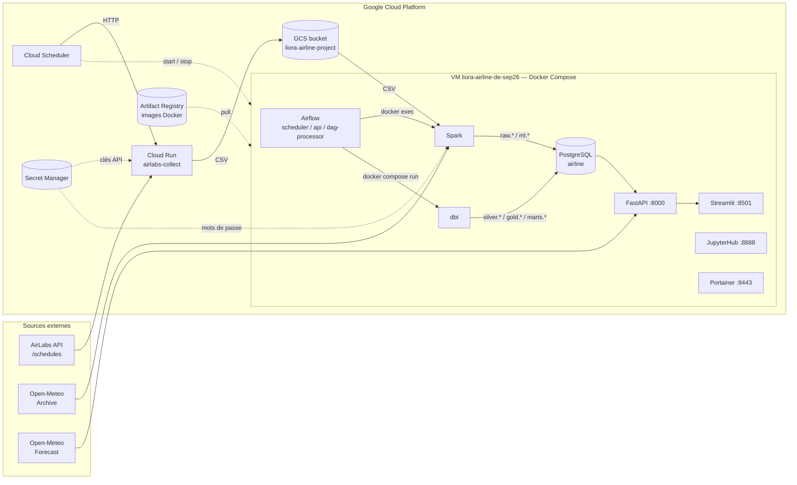
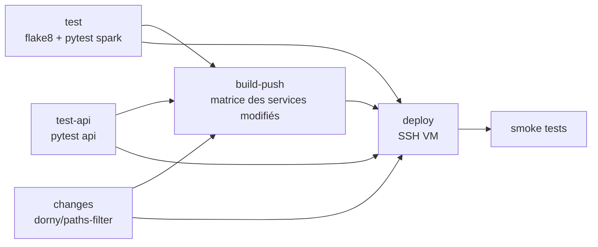

# Liora Airlines — Documentation technique

Projet Data Engineer DataScientest (promotion SEP26) : **prédiction du retard à l'arrivée des vols atterrissant à Paris** (CDG, ORY, BVA) à partir des horaires de vols AirLabs et de la météo Open-Meteo.

> Document mis à jour à partir de l'état du dépôt au commit `2acb8dd` (la version précédente décrivait le commit `deab282`).

---

## Sommaire

1. [Vue d'ensemble](#1-vue-densemble)
2. [Architecture](#2-architecture)
3. [Stack technique](#3-stack-technique)
4. [Organisation du dépôt](#4-organisation-du-dépôt)
5. [Infrastructure GCP](#5-infrastructure-gcp)
6. [Services Docker](#6-services-docker)
7. [Pipeline de données](#7-pipeline-de-données)
8. [Modèle de données (PostgreSQL)](#8-modèle-de-données-postgresql)
9. [Orchestration](#9-orchestration)
10. [Machine Learning](#10-machine-learning)
11. [API FastAPI](#11-api-fastapi)
12. [Frontend Streamlit](#12-frontend-streamlit)
13. [Sécurité et gestion des secrets](#13-sécurité-et-gestion-des-secrets)
14. [CI/CD](#14-cicd)
15. [Développement local et exploitation](#15-développement-local-et-exploitation)
16. [Tests](#16-tests)
17. [Points d'attention et dette technique](#17-points-dattention-et-dette-technique)

---

## 1. Vue d'ensemble

| Élément | Description |
|---|---|
| Objectif métier | Prédire si un vol arrivera avec plus de **15 minutes** de retard |
| Périmètre | Vols **atterris** (`status = landed`) à destination de **CDG, ORY, BVA** |
| Sources | [AirLabs API v9](https://airlabs.co) (horaires de vols, aéroports, compagnies) · [Open-Meteo](https://open-meteo.com) (archive météo horaire + prévisions) |
| Stockage | Google Cloud Storage (fichiers bruts) · PostgreSQL 18 (data warehouse en couches raw / silver / gold / marts) |
| Traitements | Spark (ingestion), dbt (transformations), scikit-learn / XGBoost (ML) |
| Orchestration | Cloud Scheduler (collecte, démarrage / arrêt de la VM) · Airflow (ingestion, dbt, entraînement) |
| Exposition | API FastAPI + interface Streamlit authentifiée par Google |
| Hébergement | GCP : une VM Compute Engine (stack Docker Compose) + un service Cloud Run (collecteur), décrits en Terraform |

---

## 2. Architecture



**Principe** : la collecte tourne en serverless (Cloud Run) et dépose des CSV dans GCS, ce qui permet d'éteindre la VM la nuit. Tout le reste (ingestion, transformation, entraînement, service) tourne sur une VM unique orchestrée par Airflow, avec des images construites par GitHub Actions et stockées dans Artifact Registry.

---

## 3. Stack technique

| Domaine | Technologie | Version / image |
|---|---|---|
| Base de données | PostgreSQL | `postgres:18-alpine` |
| Orchestration | Apache Airflow (SimpleAuthManager) | `apache/airflow:3.3.2` |
| Traitement distribué | Apache Spark (mode `local[*]`) | `apache/spark:4.0.1` |
| Transformations SQL | dbt-core + dbt-postgres, package `dbt_utils` 1.3.0 | `python:3.13-slim` |
| ML | scikit-learn 1.7.2, XGBoost 3.2.0, joblib | — |
| API | FastAPI 0.153, SQLAlchemy 2.0, Pydantic 2 | `python:3.13-slim` |
| Frontend | Streamlit ≥ 1.42 (OIDC natif), Plotly, streamlit-option-menu | `python:3.12-slim` |
| Notebooks | JupyterHub + PySpark (auth PAM) | `quay.io/jupyter/pyspark-notebook` |
| Collecteur | Python + functions-framework | `python:3.13-slim` (Cloud Run) |
| Administration conteneurs | Portainer CE | `portainer/portainer-ce:2.45.0` |
| IaC | Terraform, en modules (VM, réseau, Cloud Run, Scheduler, secrets) | provider `google` |
| CI/CD | GitHub Actions + Workload Identity Federation | — |

Connecteurs Spark embarqués dans `/opt/spark-extra-jars/` : `gcs-connector-hadoop3-latest.jar` et `postgresql-42.7.8.jar`.

---

## 4. Organisation du dépôt

```
.
├── .github/workflows/
│   ├── build-push-docker.yml     # tests → build images modifiées → déploiement VM → smoke tests
│   └── deploy-airlabs.yml        # tests → build + déploiement du collecteur sur Cloud Run
├── docker/                       # un Dockerfile par service
│   ├── collect/                  # collecteur AirLabs (Cloud Run)
│   ├── dbt/                      # + entrypoint.sh (génère ~/.dbt/profiles.yml)
│   ├── fastapi/
│   ├── jupyter/                  # + jupyterhub_config.py, start-jupyterhub.sh
│   ├── spark/
│   ├── streamlit/                # + entrypoint.sh (génère secrets.toml)
│   ├── postgres/init/            # 01-bootstrap.sh (rôles, base airflow) + 02-create_initial_db.sql (schémas, droits, tables)
│   └── postgres/migrations/      # scripts SQL (non exécutés automatiquement)
├── docker-compose.yaml           # stack de production (images Artifact Registry)
├── docker-compose.dev.yaml       # surcharge dev : build local + montage du code
├── docs/                         # cette documentation
├── infra/                        # Terraform (voir infra/README.md)
│   ├── main.tf, providers.tf, variables.tf, outputs.tf, terraform.tfvars
│   ├── imports.tf                # rattachement des ressources GCP existantes
│   └── modules/                  # vm, networking, cloud_run, scheduler, secrets
├── references/data/              # airlines.json, airports.json (référentiels)
└── src/
    ├── airflow/dags/             # DAGs (montés dans Airflow via git)
    ├── airlabs_collect/          # code du collecteur Cloud Run (+ tests/)
    ├── api/                      # FastAPI (+ tests/)
    ├── dbt/                      # projet dbt airline_platform (raw / silver / gold / marts)
    ├── frontend/                 # Streamlit
    ├── spark/notebooks/
    │   ├── common/               # Config (JSON + Secret Manager), init_spark()
    │   ├── ingestion/            # chargement AirLabs, collecte météo, rechargement UTC, config.json
    │   └── ml/                   # train_models.py, deploy_model.py
    ├── spark/tests/              # tests pytest
    ├── data/                     # scripts d'exploration/collecte historiques (OPDI, météo…)
    └── visualization/            # reste du template cookiecutter
```

---

## 5. Infrastructure GCP

| Ressource | Valeur |
|---|---|
| Projet | `project-0845983d-30e1-47a7-a62` (n° `531392170598`) |
| Région / zone | `europe-west1` / `europe-west1-c` |
| VM | `liora-airline-de-sep26`, `e2-standard-2` (2 vCPU, 8 Go), Ops Agent installé |
| Bucket GCS | `liora-airline-project` |
| Artifact Registry | `europe-west1-docker.pkg.dev/project-0845983d-30e1-47a7-a62/airline/<service>` |
| Cloud Run | `liora-airline-project-sep26-airlabs-collect` |
| Secret Manager | `airlabs-api-keys`, `AIRLINEDB_PASSWORD`, `AIRLINEBUCKET_CREDENTIALS` |

### Cloud Scheduler

Les horaires sont exprimés en heure de Paris (`time_zone = Europe/Paris`) ; GCP gère le passage heure d'été / heure d'hiver.

| Job | Planification | Action |
|---|---|---|
| `Collect-AirLabs` | `0 1,3,7,9,11,13,15,17,19,21,23 * * *` | Appel HTTP du Cloud Run de collecte |
| `Start_VM` | `0 8 * * *` | Démarrage de la VM (API Compute Engine) |
| `Stop_VM` | `0 21 * * *` | Arrêt de la VM (réduction des coûts) |

### Terraform

Le dossier [infra/](../infra/README.md) décrit l'infrastructure **existante** : il a été exporté depuis GCP et les blocs `import {}` de `imports.tf` rattachent les ressources déjà créées. Il n'y a pas de backend distant : `terraform plan` sert à vérifier l'écart entre le code et GCP.

| Module | Contenu |
|---|---|
| `vm` | Instance Compute Engine et son disque |
| `networking` | Règles de pare-feu du réseau `default` (http, https, icmp, internal, rdp, ssh) |
| `cloud_run` | Service de collecte AirLabs |
| `scheduler` | Jobs Cloud Scheduler (collecte + start / stop de la VM) |
| `secrets` | Secrets Secret Manager et droits d'accès (les **valeurs** ne sont pas gérées par Terraform) |

### Arborescences

VM :

| Chemin | Usage |
|---|---|
| `/home/airline/repos` | clone *sparse* du dépôt (`src/airflow/dags`, `docker/postgres/init`, `docker/airflow`) + `.env` + `docker-compose.yaml` |
| `/home/airline/workspace/spark` | volume partagé Spark ↔ API (contient `models/*.joblib`) |
| `/home/airline/workspace/jupyter/notebooks` | espace de travail JupyterHub |

Bucket :

| Préfixe | Contenu |
|---|---|
| `raw/airlabs/` | CSV fraîchement collectés (`schedule_<cdg|ory|bva>_<YYYYMMDDHH>.csv`) |
| `raw/processed/airlabs/` | CSV déjà chargés en base (archivés par Spark) |
| `raw/meteo/` | historique météo initial (scripts `src/data`) |

---

## 6. Services Docker

Défini dans [docker-compose.yaml](../docker-compose.yaml).

| Service | Conteneur | Port(s) | Rôle |
|---|---|---|---|
| `database` | `pg_container` | 127.0.0.1:5432 | PostgreSQL : bases `airline` et `airflow` |
| `spark` | `spark` | — | Conteneur « toujours allumé » (`tail -f /dev/null`) dans lequel Airflow lance des `spark-submit` |
| `jupyter` | `jupyter_pyspark` | 8888, 127.0.0.1:4040 | JupyterHub multi-utilisateurs + UI Spark (utilisé pour les tests) |
| `airflow-init` | — | — | `airflow db migrate` (one-shot) |
| `airflow-scheduler` | `airflow_scheduler` | — | Scheduler ; a accès au socket Docker de l'hôte |
| `airflow-api-server` | `airflow_api_server` | 8080 | UI + API Airflow 3 |
| `airflow-dag-processor` | `airflow_dag_processor` | — | Parsing des DAGs |
| `portainer` | `portainer` | 127.0.0.1:9443 | Administration Docker (local uniquement, accès via tunnel SSH) |
| `dbt` | `dbt` | — | Profil `tools` : lancé à la demande (`docker compose run --rm dbt …`) |
| `api` | `airline_api` | 127.0.0.1:8000 | API FastAPI |
| `frontend` | `frontend` | 8501 | Application Streamlit |

Volumes nommés : `postgres_data`, `airflow_logs`, `portainer_data`, `mlflow_artifacts` (inutilisé).

**Pattern d'exécution** : Airflow ne contient ni Spark ni dbt. Il pilote les autres conteneurs via le socket Docker monté :
- Spark : `docker exec spark /opt/spark/bin/spark-submit --jars … <script>.py`
- dbt : `docker compose -f /home/airline/repos/docker-compose.yaml --profile tools run --rm dbt bash -c "dbt deps && dbt <cmd>"`

---

## 7. Pipeline de données

```mermaid
flowchart TB
    A[AirLabs /schedules<br/>arr_iata = CDG, ORY, BVA] -->|Cloud Run| B[GCS raw/airlabs/*.csv]
    B -->|load_airlabs_schedule_files.py| C[(raw.airlabs_schedules)]
    C --> D{collect_meteo_airlabs.py<br/>jours manquants par aéroport}
    E[Open-Meteo Archive] --> D
    D --> F[(raw.meteo_hourly)]
    G[(raw.airlabs_airports<br/>raw.airlabs_airlines)]
    C & F & G -->|dbt| H[silver.stg_*]
    H -->|dbt| I[gold.dim_* / fact_*]
    I -->|dbt| J[(marts.mrt_ml_flights_features<br/>marts.mrt_delay_by_*)]
    J -->|train_models.py| K[(ml.model_runs)<br/>+ models/*.joblib]
```

### 7.1 Collecte AirLabs (Cloud Run)

Code : [src/airlabs_collect/](../src/airlabs_collect/) — point d'entrée HTTP `run_http` ([main.py](../src/airlabs_collect/main.py)), déclenché par Cloud Scheduler.

1. **Sélection de la clé API** : lit la liste de clés (secret `AIRLABS_API_KEYS`, JSON `[{name, key}]`), appelle `/api/v9/ping` et retient la première clé encore valide (rotation des quotas gratuits : 1 000 requêtes par clé et par mois). Si aucune clé n'est disponible, le script lève une erreur explicite (`RuntimeError`).
2. **Lecture de la configuration** [airports.json](../src/airlabs_collect/airports.json) : une entrée par aéroport d'arrivée (`url`, `params` avec `{API_KEY}`, `pattern` du nom de fichier).
3. **Collecte paginée** (`offset`, `has_more`, 50 lignes par appel), 3 tentatives par page avec 10 s d'attente, 10 s entre les pages. Seuls les vols `landed` sont conservés.
4. **Écriture CSV** (union des colonnes, structures imbriquées sérialisées en JSON) dans un fichier temporaire puis **upload** vers `gs://liora-airline-project/raw/airlabs/` (variable `BUCKET_PATH`). Aucun fichier n'est écrit si la collecte ne renvoie rien.

La collecte a lieu toutes les 2 h car l'API ne renvoie les vols atterris que sur les 2 dernières heures. Le script peut aussi être lancé en CLI (`--api-keys-file`, `--airports`, `--dir`, `--bucket-path`, `--google-credentials`).

### 7.2 Ingestion des horaires (Spark)

Script : [load_airlabs_schedule_files.py](../src/spark/notebooks/ingestion/load_airlabs_schedule_files.py) — config : [config.json](../src/spark/notebooks/ingestion/config.json).

1. Charge `config.json` puis les secrets `AIRLINEDB_PASSWORD` / `AIRLINEBUCKET_CREDENTIALS` depuis Secret Manager (`Config.get_secrets()`).
2. Lit tous les CSV de `raw/airlabs/` (`gs://…`), ajoute la colonne `source_file`.
3. Nettoyage : lignes vides, filtre `landed`, colonnes clés non nulles, typage (timestamps, entiers), dédoublonnage sur `(airline_icao, flight_number, dep_iata, dep_time, arr_iata)`.
4. Écrit dans une table de staging unique `temp.staging_airlabs_schedule_<uuid>` (JDBC).
5. `INSERT … SELECT DISTINCT … ON CONFLICT DO NOTHING` dans `raw.airlabs_schedules` (idempotent), puis supprime la staging. Les colonnes UTC (`dep_time_utc`, `arr_time_utc`, `dep_actual_utc`, `arr_actual_utc`) sont chargées directement.
6. Déplace les fichiers traités vers `raw/processed/airlabs/`.

**Rechargement de l'historique UTC** : les premiers fichiers avaient été chargés en UTC, les suivants en heure locale. Le script ponctuel [update_airlabs_utc.py](../src/spark/notebooks/ingestion/update_airlabs_utc.py) a relu les fichiers déjà traités (`raw/processed/airlabs/`) et rempli les colonnes `*_utc` de tout l'historique (jointure sur la clé du vol). Depuis, tout le pipeline travaille en UTC.

### 7.3 Collecte météo (Spark + Open-Meteo)

Script : [collect_meteo_airlabs.py](../src/spark/notebooks/ingestion/collect_meteo_airlabs.py).

1. Calcule en SQL, pour chaque aéroport (départ **et** arrivée), les **jours avec vols** qui n'ont pas encore leurs **24 heures** de météo dans `raw.meteo_hourly`. L'ICAO est pris dans le vol ou déduit de l'IATA via `raw.airlabs_airports` (les codes erronés `OPRN` et `UGGG` sont exclus).
2. Ne demande que les jours ≤ *aujourd'hui − `METEO_ARCHIVE_DELAY_DAYS`* (5 par défaut, délai de publication de l'archive).
3. Un appel par aéroport sur la plage de jours manquants ; arrêt propre au premier **HTTP 429** (la prochaine exécution reprend).
4. Staging `temp.staging_meteo_hourly_<uuid>` puis `INSERT … ON CONFLICT (icao, time) DO NOTHING`.

Variables horaires collectées : `temperature_2m`, `dew_point_2m`, `relative_humidity_2m`, `pressure_msl`, `cloud_cover` (+ `_low/_mid/_high`), `wind_speed_10m`, `wind_direction_10m`, `wind_gusts_10m`, `precipitation`, `rain`, `snowfall`, `weather_code`.

### 7.4 Transformations dbt

Projet : [src/dbt/](../src/dbt/) (`airline_platform`, profil `dataplatform`). La macro `generate_schema_name` force l'utilisation du schéma déclaré tel quel (`raw`, `silver`, `gold`, `marts`) sans préfixe. Chaque modèle accorde les droits de lecture à `airline_rw` en `post_hook`.

**Seeds** (schéma `raw`) :
- `airport_corrections.csv` : codes ICAO à écarter (`OPRN→OPIS`, `UGGG→UGTB`).
- `weather_codes.csv` : libellés des codes météo WMO 4677.

**Silver** (tables, avec index en `post_hook`) :

| Modèle | Source | Rôle |
|---|---|---|
| `stg_airports` | `raw.airlabs_airports` | Dédoublonnage par ICAO, clé `airport_id = md5(icao_code)` |
| `stg_airlines` | `raw.airlabs_airlines` | Dédoublonnage par ICAO, clé `airline_id` |
| `stg_schedules` | `raw.airlabs_schedules` | Vol réel (une ligne par vol daté) : heures prévues et réelles de départ et d'arrivée lues dans les colonnes **`*_utc` d'AirLabs**, dédoublonnage des *code-shares*, résolution des aéroports par ICAO (fallback IATA), `delayed = arr_delayed` |
| `stg_flights` | `raw.airlabs_schedules` | Vol « catalogue » (ligne régulière) : agrégat par vol / aéroports / heures / jour de semaine, avec nombre d'`occurences` |
| `stg_weather_hourly` | `raw.meteo_hourly` | Ajoute `airport_id` et l'encodage cyclique du vent (`sin`/`cos`) |

**Gold** (modèle en étoile) :

| Modèle | Matérialisation | Rôle |
|---|---|---|
| `dim_airports`, `dim_airlines`, `dim_flights` | vues | Exposition des tables silver (lues par l'API) |
| `dim_weather_codes` | table | Code, libellé, catégorie (`code/10`) et sous-catégorie |
| `fact_flights` | table | Un vol réalisé : `dep_hour` et `arr_hour` (heures prévues tronquées, clés de jointure météo), heures d'arrivée prévue/réelle UTC, `dow` et `arr_hour_local` (Europe/Paris), `arr_delay_min`, **`delay = arr_delay_min > 15`** |
| `fact_weather_hourly` | table | Météo horaire limitée à la période couverte par AirLabs |

**Marts** (tables prêtes à l'usage) :

| Modèle | Rôle |
|---|---|
| `mrt_ml_flights_features` | Table d'entraînement : `fact_flights` ⨝ dimensions ⨝ météo **à l'arrivée** (aéroport et heure d'arrivée prévus, colonnes `arr_*`) et **au départ** (aéroport et heure de départ prévus, colonnes `dep_*`) |
| `mrt_delay_by_hour` | Par heure d'arrivée locale : nombre de vols, nombre et taux de retards, retard moyen |
| `mrt_delay_by_airline` | Mêmes indicateurs par compagnie |
| `mrt_delay_by_airport` | Mêmes indicateurs par aéroport de départ |

Les calculs sont faits une seule fois par dbt ; l'API et l'interface se contentent de lire les marts.

**Tests dbt** (`schema.yml` par couche) : `unique` / `not_null` sur toutes les clés, `relationships` (`fact_flights → dim_airports / dim_airlines`, `fact_weather_hourly → dim_weather_codes`), `unique_combination_of_columns (icao, time)` sur la météo, `not_null` sur la cible `delay` de la table d'entraînement. Les tables et colonnes sont documentées dans les mêmes fichiers (lignage via `dbt docs`).

---

## 8. Modèle de données (PostgreSQL)

Base **`airline`**, initialisée au premier démarrage par [02-create_initial_db.sql](../docker/postgres/init/02-create_initial_db.sql) (schémas, droits, tables raw, codes météo, `ml.model_runs`) :

| Schéma | Alimenté par | Contenu |
|---|---|---|
| `raw` | Spark, seeds dbt, scripts de chargement initiaux | `airlabs_schedules`, `airlabs_airports`, `airlabs_airlines`, `meteo_hourly`, `airport_corrections`, `weather_codes`, tables annexes (`airports`, `excluded_dates`, `icao_corrections`, `wiki_airline_types`) |
| `temp` | Spark | Tables de staging éphémères (supprimées en fin de job) |
| `silver` | dbt | `stg_*` |
| `gold` | dbt | Dimensions et faits |
| `marts` | dbt | Table d'entraînement et agrégats de retards |
| `ml` | `train_models.py` | `model_runs` (historique des modèles) |

Base **`airflow`** : métadonnées Airflow (propriétaire `airflow`).

### Table `raw.airlabs_schedules` (principale)

Clé technique `id` (identity), contrainte d'unicité `(airline_icao, flight_number, dep_iata, dep_time, arr_iata)`. Colonnes : `airline_icao`, `flight_icao`, `flight_number`, `dep_iata`, `dep_icao`, `dep_time`, `dep_estimated`, `dep_actual`, `arr_iata`, `arr_icao`, `arr_time`, `arr_estimated`, `arr_actual`, `cs_flight_iata`, `status`, `duration`, `dep_delayed`, `arr_delayed`, `dep_time_utc`, `dep_actual_utc`, `arr_time_utc`, `arr_actual_utc`, `source_file`.

### Table `ml.model_runs`

| Colonne | Description |
|---|---|
| `model_name` (PK) | `<type>_<YYYYMMDD_HHMM>` (ex. `xgb_20261027_1453`) |
| `model_type` | `rf` ou `xgb` |
| `trained_at` | horodatage UTC |
| `train_rows`, `test_rows`, `train_days`, `test_days`, `train_delay_rate`, `test_delay_rate` | description du split |
| `tp`, `fp`, `tn`, `fn`, `precision`, `recall`, `f1`, `roc_auc` | scores sur le jeu de test |
| `training_seconds`, `model_path` | durée et fichier `.joblib` |
| `deployed_at`, `online` | date du dernier déploiement ; **un seul** modèle `online = true` |

---

## 9. Orchestration

DAGs dans [src/airflow/dags/](../src/airflow/dags/), montés en volume (déployés par `git` sur la VM, pas d'image à reconstruire). Horaires en UTC.

| DAG | Planification | Tâches |
|---|---|---|
| `ingest_airlabs_schedule` | `30 8,14,20 * * *` | `run_airlabs_ingestion` (Spark) → `run_meteo_collect` (Spark) |
| `airline_pipeline` | `30 8,14 * * *` | `dbt_seed` → `dbt_run` → `dbt_test` → `dbt_docs` (les étapes suivantes tournent même en cas d'échec : `ALL_DONE`) |
| `train_models_weekly` | `0 10 * * 5` (vendredi) | `run_train_models` (Spark) : entraînement RandomForest + XGBoost |
| `test` | manuel | `sleep 5 && echo hello` (vérification de l'installation) |

Hors Airflow, Cloud Scheduler déclenche la collecte AirLabs et le démarrage / l'arrêt de la VM (voir §5).

Authentification Airflow : `SimpleAuthManager`, utilisateurs `herve` et `pascal` (admin), mots de passe dans `docker/airflow/passwords.json` (généré sur la VM par la CI depuis le secret `AIRFLOW_PASSWORDS`).

---

## 10. Machine Learning

### 10.1 Entraînement — [train_models.py](../src/spark/notebooks/ml/train_models.py)

| Étape | Détail |
|---|---|
| Données | `marts.mrt_ml_flights_features` ; vols sans météo à l'arrivée ou au départ exclus (principalement les 5 derniers jours, en attente de l'archive) |
| Cible | `delay` (retard à l'arrivée > 15 min) |
| Variables catégorielles | `airline_icao`, `adep`, `ades` → `OneHotEncoder(handle_unknown="ignore")` |
| Variables numériques | `dow`, `arr_hour_local`, 15 variables météo **à l'arrivée** (`arr_*`) et les mêmes 15 **au départ** (`dep_*`) : température, écart température/point de rosée, humidité, pression, nébulosités, vent sin/cos, rafales, précipitations, neige, code météo |
| Split | `GroupShuffleSplit` 80/20 **par jour entier** (aucun jour partagé train/test, évite la fuite météo) |
| Modèles | `RandomForestClassifier` (100 arbres, `class_weight="balanced"`) et `XGBClassifier` (300 arbres, profondeur 6, lr 0.1, `scale_pos_weight` = ratio de classes) |
| Évaluation | Matrice de confusion, précision, rappel, F1 (classe retard), ROC AUC, seuil 0,5 |
| Artefacts | Pipeline complet (prétraitement + modèle) sérialisé en `/app/workspace/models/<model_name>.joblib` ; une ligne par modèle dans `ml.model_runs` |

Lancement : automatique chaque vendredi à 10 h UTC (DAG `train_models_weekly`), ou manuel :

```bash
docker exec spark /opt/spark/bin/spark-submit /app/src/notebooks/ml/train_models.py
```

**Résultats** : AUC autour de 0,6. Le XGBoost détecte environ la moitié des retards ; le RandomForest presque aucun au seuil de 0,5. La principale cause de retard (retard de l'avion sur son vol précédent) n'est pas disponible au moment de la prédiction.

### 10.2 Déploiement d'un modèle

Le déploiement n'est pas automatique : un nouveau modèle n'est mis en ligne qu'après validation humaine de ses scores. Deux méthodes équivalentes :

- **Depuis l'interface** Streamlit (menu *Modèles*) → `POST /models/{model_name}/deploy` : copie atomique (`.tmp` + `os.replace`) vers `model.joblib`, mise à jour de `online` / `deployed_at`, **rechargement à chaud** dans l'API.
- **En ligne de commande** :
  ```bash
  docker exec spark /opt/spark/bin/spark-submit /app/src/notebooks/ml/deploy_model.py xgb_20261027_1453
  ```
  puis redémarrer l'API (`docker compose restart api`).

Le répertoire `/home/airline/workspace/spark` est monté à la fois dans `spark` et `api` (`/app/workspace`), ce qui permet le partage des fichiers modèles. Les versions de scikit-learn et XGBoost doivent être identiques dans les deux conteneurs.

### 10.3 Inférence

[ml_model.py](../src/api/ml_model.py) + [flight_predictor.py](../src/api/flight_predictor.py) :
1. Pour chaque vol, récupère la **prévision** Open-Meteo (API Forecast) :
   - à l'aéroport d'arrivée, pour l'heure d'arrivée (`get_weather`) ;
   - à l'aéroport de départ, pour l'heure de départ en heure locale de l'aéroport (`get_dep_weather`, `timezone=auto`).
2. Reconstruit exactement les colonnes de `marts.mrt_ml_flights_features` (`build_features`).
3. `predict` / `predict_proba` → `is_delayed = proba ≥ 0,5`, `delay_probability`.

---

## 11. API FastAPI

Code : [src/api/](../src/api/). Documentation interactive : `http://localhost:8000/docs` (via tunnel SSH sur la VM).

**Authentification** : toutes les routes exigent l'en-tête `X-API-Key` (comparaison à temps constant, `secrets.compare_digest`). Valeur : variable `API_KEY` (secret `FASTAPI_KEY`).

| Méthode | Route | Description |
|---|---|---|
| `POST` | `/predict` | Prédiction pour un vol (`{"flight": Flight}`) → `PredictionOutput` |
| `POST` | `/flights` | Recherche de vols catalogue (`gold.dim_flights`) : origine, destination et date obligatoires ; compagnie (nom ou codes ICAO) et plage horaire optionnelles ; pagination |
| `GET` | `/airports` | Aéroports (`search`, `country`) |
| `GET` | `/airlines` | Compagnies (`search`) |
| `GET` | `/stats/hour` | Retards par heure d'arrivée (`marts.mrt_delay_by_hour`) |
| `GET` | `/stats/airline` | Retards par compagnie (`marts.mrt_delay_by_airline`) |
| `GET` | `/stats/airport` | Retards par aéroport de départ (`marts.mrt_delay_by_airport`) |
| `GET` | `/models` | Liste des modèles de `ml.model_runs` |
| `POST` | `/models/{model_name}/deploy` | Déploie et recharge un modèle (nom validé, 404 si modèle ou fichier inconnu) |

La route `/predict-batch` est désactivée (commentée).

Détails de `/flights` : le jour de la semaine est calculé au format PostgreSQL (`EXTRACT(DOW)`, dimanche = 0) ; le nom de compagnie est recherché en `ILIKE '%…%'` ; les erreurs renvoient un code HTTP explicite (422 pour un paramètre manquant ou une date invalide, 500 pour une erreur base, journalisée).

Configuration ([config.py](../src/api/config.py)) : `API_KEY`, `PG_USER`, `PG_PASSWORD`, `PG_HOST`, `PG_PORT`, `PG_DB`, `MODEL_PATH` (défaut `/app/workspace/models/model.joblib`), `CORS_ORIGINS`. Pool SQLAlchemy : 5 connexions + 10 en débordement, `pool_pre_ping`.

Le modèle est chargé au démarrage (`lifespan`) ; si le fichier est absent, l'API démarre quand même et renvoie **503** sur les prédictions.

---

## 12. Frontend Streamlit

Code : [src/frontend/](../src/frontend/), point d'entrée [app.py](../src/frontend/app.py).

- **Authentification** : OIDC Google natif de Streamlit (`st.login`). Le fichier `~/.streamlit/secrets.toml` est généré au démarrage par [entrypoint.sh](../docker/streamlit/entrypoint.sh) à partir de `GOOGLE_CLIENT_ID`, `GOOGLE_CLIENT_SECRET`, `COOKIE_SECRET`. Un mode démo (bypass) est contrôlé par `ALLOW_DEV_BYPASS_GOOGLE_AUTH`.
- **Client API** : [api_client.py](../src/frontend/api_client.py) (en-tête `X-API-Key`, cache Streamlit des référentiels).

| Menu | Vue | Fonction |
|---|---|---|
| Prédiction un vol | `predict_single.py` | Choix origine / destination parisienne / date / heure, compagnie optionnelle → recherche `/flights` puis prédiction `/predict` |
| Statistiques › Modèle (Graphiques) | `statistics.py` | Scores des modèles entraînés (`/models`) |
| Statistiques › Data | `statistics.py` | Retards à l'arrivée par heure, compagnie et aéroport (`/stats/*`) |
| Références | `references.py` | Tables Compagnies et Aéroports |
| Modèles | `models.py` | Liste des modèles et scores, déploiement avec boîte de confirmation |

---

## 13. Sécurité et gestion des secrets

### Rôles PostgreSQL

Scripts de [docker/postgres/init/](../docker/postgres/init/), exécutés **uniquement au premier démarrage** (volume `postgres_data` vide) : `01-bootstrap.sh` crée les rôles et la base `airflow`, `02-create_initial_db.sql` crée les schémas, les droits et les tables.

| Rôle | Usage |
|---|---|
| `admin` | super-utilisateur (`POSTGRES_USER`) |
| `batch` | compte technique Spark / dbt / API |
| `herve`, `pascal` | comptes nominatifs des développeurs |
| `airflow` | propriétaire de la base `airflow` |
| `airline_rw` | rôle groupe (lecture/écriture `raw`, `silver`, `gold`) attribué à tous ; privilèges par défaut sur les futurs objets ; droits sur `marts` accordés par les `post_hook` dbt |

### Secrets

| Où | Secrets |
|---|---|
| GitHub Actions | `GCP_WORKLOAD_IDENTITY_PROVIDER`, `GCP_DEPLOY_SERVICE_ACCOUNT`, `GCP_VM_HOST`, `GCP_VM_USER`, `GCP_VM_SSH_KEY`, `PG_ADMIN_PASSWORD`, `DBT_BATCH_PASSWORD`, `HERVE_PASSWORD`, `PASCAL_PASSWORD`, `AIRFLOW_PASSWORD`, `AIRFLOW_DB_CONN`, `AIRFLOW_JWT_SECRET`, `AIRFLOW_PASSWORDS`, `JUPYTER_PASSWORD_HERVE`, `JUPYTER_PASSWORD_PASCAL`, `FASTAPI_KEY`, `GOOGLE_CLIENT_ID`, `GOOGLE_CLIENT_SECRET`, `COOKIE_SECRET` |
| GCP Secret Manager | `airlabs-api-keys` (Cloud Run), `AIRLINEDB_PASSWORD`, `AIRLINEBUCKET_CREDENTIALS` (jobs Spark) |
| VM | `/home/airline/repos/.env` et `docker/airflow/passwords.json`, **réécrits à chaque déploiement** par la CI |

**Accès à GCP** :
- depuis GitHub Actions (Artifact Registry, Cloud Run) : **Workload Identity Federation**, avec un jeton OIDC temporaire, sans clé de compte de service ;
- depuis la VM et le Cloud Run (Secret Manager, bucket) : identité du service, sans clé ;
- déploiement sur la VM : clé privée SSH (`GCP_VM_SSH_KEY`) stockée dans GitHub Secrets.

**Autres bonnes pratiques en place** : `.dockerignore` excluant `.env` / `passwords.json` / `.git`, PostgreSQL / API / Portainer / UI Spark liés à `127.0.0.1` (accès distant par tunnel SSH), CORS de l'API fermé par défaut, `.gitattributes` forçant les fins de ligne LF pour les scripts shell, fichiers d'état Terraform exclus de Git.

---

## 14. CI/CD

### 14.1 `build-push-docker.yml` — stack de la VM

Déclenchement :
- **push sur `master`** (chemins `docker/**` hors `docker/collect`, `src/api/**`, `src/frontend/**`, `src/spark/**`, `src/dbt/**`) : chaîne complète ;
- **Pull Request vers `master`** (chemins `src/**` hors `src/airlabs_collect`) : tests uniquement ;
- manuel (`workflow_dispatch`).



1. **test** : Python 3.10, `flake8` bloquant sur les erreurs de syntaxe / noms indéfinis de `src/spark`, `pytest src/spark/tests`.
2. **test-api** : Python 3.12 (pandas 3 exige ≥ 3.11), `pytest api/tests`.
3. **changes** : détermine quels services (`api`, `frontend`, `jupyter`, `spark`, `dbt`) ont changé (Dockerfile ou sources) ; tous en déclenchement manuel.
4. **build-push** (pas sur les PR) : build Buildx (cache GHA par service), push des tags `:<sha>` et `:latest` dans Artifact Registry.
5. **deploy** (pas sur les PR, sérialisé via `concurrency: deploy-vm`) : écrit `.env` et `passwords.json` sur la VM par SSH, `git sparse-checkout` + checkout de la branche, `docker compose pull` puis `up -d`, nettoyage des images.
6. **smoke tests** : état `running` des conteneurs, santé HTTP (FastAPI `/docs`, Streamlit `/_stcore/health`, JupyterHub `/hub/health`, Airflow `/api/v2/monitor/health`, Portainer), `pg_isready`, présence des jars et scripts Spark, `dbt debug` lancé depuis Airflow, erreurs d'import des DAGs (informatif).

> Un workflow par service aurait été plus simple ; le workflow intégré a été choisi pour explorer les possibilités de GitHub Actions (matrice, détection de changements, dépendances entre jobs).

### 14.2 `deploy-airlabs.yml` — collecteur Cloud Run

Déclenchement : changements dans `src/airlabs_collect/**`, `docker/collect/**` ou le workflow lui-même.

1. **test** : Python 3.10, `flake8` bloquant sur `src/airlabs_collect`, `pytest src/airlabs_collect/tests`.
2. **deploy** (après les tests) : build de l'image `airlabs-collect:<sha>`, push dans Artifact Registry, puis `deploy-cloudrun` avec injection du secret `AIRLABS_API_KEYS=airlabs-api-keys:latest`.

---

## 15. Développement local et exploitation

### Lancer la stack en local (build des images + code monté)

Pré-requis : un fichier `.env` à la racine contenant les variables listées au §13 (`PG_ADMIN_PASSWORD`, `DBT_BATCH_PASSWORD`, `FASTAPI_KEY`, …) et `docker/airflow/passwords.json`.

```bash
docker compose -f docker-compose.yaml -f docker-compose.dev.yaml up --build
```

> Les services `spark`, `jupyter` et `api` montent des chemins `/home/airline/workspace/...` propres à la VM : à adapter sous Windows/macOS.

### Débogage des jobs Spark sous Windows

Voir [src/spark/notebooks/README.md](../src/spark/notebooks/README.md) : JDK 17, `JAVA_HOME`, paquets Python, `gcloud auth application-default login`. Hors Docker (`RUN_ENV` ≠ `docker`), les scripts se connectent à PostgreSQL sur `localhost` (tunnel SSH vers la VM).

### Commandes utiles sur la VM

```bash
cd /home/airline/repos && docker compose ps
```

```bash
docker compose --profile tools run --rm dbt bash -c "dbt deps && dbt run --select marts"
```

```bash
docker exec spark /opt/spark/bin/spark-submit --jars /opt/spark-extra-jars/gcs-connector.jar,/opt/spark-extra-jars/postgresql.jar /app/src/notebooks/ingestion/load_airlabs_schedule_files.py
```

```bash
docker exec airflow_scheduler airflow dags trigger airline_pipeline
```

```bash
docker exec airflow_scheduler airflow dags trigger train_models_weekly
```

### Terraform

```bash
cd infra
terraform init -backend=false
terraform validate
terraform plan -input=false -lock=false   # lecture seule : compare le code à GCP
```

### Accès aux interfaces

| Interface | URL |
|---|---|
| Streamlit | `http://<vm>:8501` |
| Airflow | `http://<vm>:8080` |
| JupyterHub | `http://<vm>:8888` |
| FastAPI (Swagger) | `ssh -L 8000:127.0.0.1:8000 <user>@<vm>` puis `http://localhost:8000/docs` |
| PostgreSQL | `ssh -L 5432:127.0.0.1:5432 <user>@<vm>` puis `localhost:5432` |
| Portainer | `ssh -L 9443:127.0.0.1:9443 <user>@<vm>` puis `https://localhost:9443` |

La VM est éteinte entre 21 h et 8 h (heure de Paris).

---

## 16. Tests

| Niveau | Outil | Contenu |
|---|---|---|
| Unitaires Spark | pytest (`src/spark/tests`, 8 tests) | `Config` (chargement, accès `[]`/attribut, secrets mockés) et `init_spark` (variables d'environnement, configuration Hadoop GCS) |
| Unitaires API | pytest (`src/api/tests`, 25 tests) | Recherche de vols (`/flights`, paramètres obligatoires, compagnie optionnelle, jour de la semaine), référentiels et statistiques, liste et déploiement des modèles, sécurité (`X-API-Key`). Base et modèle simulés (`conftest.py`) |
| Unitaires collecteur | pytest (`src/airlabs_collect/tests`, 27 tests) | Sélection de clé, pagination, écriture CSV, upload GCS, point d'entrée HTTP, configuration |
| Qualité | flake8 | erreurs bloquantes (E9, F63, F7, F82) + rapport de complexité |
| Données | dbt test | unicité, non-nullité, intégrité référentielle |
| Déploiement | smoke tests CI | conteneurs, endpoints de santé, connexion dbt |

```bash
cd src
pytest spark/tests
pytest api/tests
pytest airlabs_collect/tests
```

---

## 17. Points d'attention et dette technique

### Corrigé depuis la version précédente de ce document

- `/stats` remplacé par `/stats/hour|airline|airport`, qui lisent les marts.
- `/flights` : codes HTTP explicites, recherche `ILIKE` corrigée, jour de la semaine aligné sur `EXTRACT(DOW)` (dimanche = 0), compagnie optionnelle.
- Collecteur : erreur explicite si aucune clé valide, option `--google-credentials` corrigée, pas de fichier vide écrit.
- Entraînement orchestré (`train_models_weekly`) et météo au départ ajoutée aux variables.
- Pipeline en UTC (colonnes `*_utc` d'AirLabs + rechargement de l'historique).
- Tests de l'API et du collecteur ajoutés à la CI.
- PostgreSQL, API et UI Spark liés à `127.0.0.1`.
- Infrastructure Terraform complète (modules) à la place du seul fichier de VM.
- Nettoyage : `docker/airflow/Dockerfile`, `docker/mlflow/`, `src/models`, `src/features` supprimés ; README réécrit.

### Bugs probables

| Emplacement | Constat |
|---|---|
| [api/ml_model.py](../src/api/ml_model.py) | `predicted_delay_minutes` contient la classe prédite (0/1), pas des minutes |
| [frontend/views/predict_batch.py](../src/frontend/views/predict_batch.py) | Utilise l'ancien format de vol (`airline_code`, `distance`…) ; la vue est encore importée dans `app.py` mais plus accessible depuis le menu, et `/predict-batch` est désactivé |
| [frontend/views/references.py](../src/frontend/views/references.py) | `_render_flights()` n'est plus appelée (table Flights retirée du menu) |
| [api/main.py](../src/api/main.py) `/flights` | Le message d'erreur 422 indique encore la compagnie comme obligatoire |
| [docker-compose.yaml](../docker-compose.yaml) | Healthcheck PostgreSQL sur `-d airflow` alors que la base principale est `airline` (fonctionne car `pg_isready` teste le serveur) |

### Orchestration

- `airline_pipeline` (dbt) et `ingest_airlabs_schedule` partent tous deux à 08:30 et 14:30 UTC sans dépendance : dbt peut transformer des données pas encore chargées. Piste : décaler dbt ou le déclencher via un `Asset` / `TriggerDagRunOperator` à la fin de l'ingestion.
- L'exécution de 20:30 UTC de `ingest_airlabs_schedule` tombe après l'arrêt de la VM (21 h heure de Paris, soit 20 h UTC en hiver et 19 h UTC en été) : elle ne s'exécute pas. Les fichiers sont rattrapés à 08:30, donc sans perte de données.
- `train_models_weekly` n'attend pas la fin de dbt : il repose sur le décalage horaire (vendredi 10 h, après le dbt de 8 h 30).
- Le job `Collect-AirLabs` ne tourne pas à 5 h (heure de Paris) : il y a un trou de 4 h dans la nuit, alors que l'API ne renvoie que les 2 dernières heures.

### Sécurité

- `ALLOW_DEV_BYPASS_GOOGLE_AUTH` vaut `true` par défaut ([frontend/config.py](../src/frontend/config.py)) : le bouton « Mode Démo Dev » permet d'entrer sans compte Google si la variable n'est pas définie à `false` en production.
- `redirect_uri` Streamlit codé en dur sur `http://localhost:8501`.
- Airflow (8080), JupyterHub (8888) et Streamlit (8501) sont publiés sur toutes les interfaces : la protection repose sur les règles de pare-feu GCP.
- `.env` et `passwords.json` écrits en `chmod 666` sur la VM.
- Le déploiement utilise une clé SSH longue durée ; piste : `gcloud compute ssh --tunnel-through-iap` avec l'identité Workload Identity, pour supprimer la clé et fermer le port 22.

### Code mort / à nettoyer

- `docker/postgres/migrations/V1__create_airlabs_schedules.sql` incomplet et non exécuté ; doublon avec `02-create_initial_db.sql`.
- `src/dbt/profile.yml` non utilisé (le profil est généré par `entrypoint.sh`).
- `src/data/collect_airlabs.py` duplique `src/airlabs_collect/airlabs.py` ; `src/visualization` vide (template).
- `deploy-airlabs.yml` se déclenche encore sur la branche `change-docker-architecture` (« à retirer après la fusion »).
- Socket Docker monté deux fois dans `airflow-scheduler`.
- Volume `mlflow_artifacts` déclaré mais inutilisé.
- Images `jupyter` et jars GCS (`gcs-connector-hadoop3-latest`) non épinglés en version : builds non reproductibles.
- Liste des variables du modèle définie à trois endroits (dbt, `train_models.py`, `flight_predictor.py`) : une liste partagée réduirait le risque d'écart.
