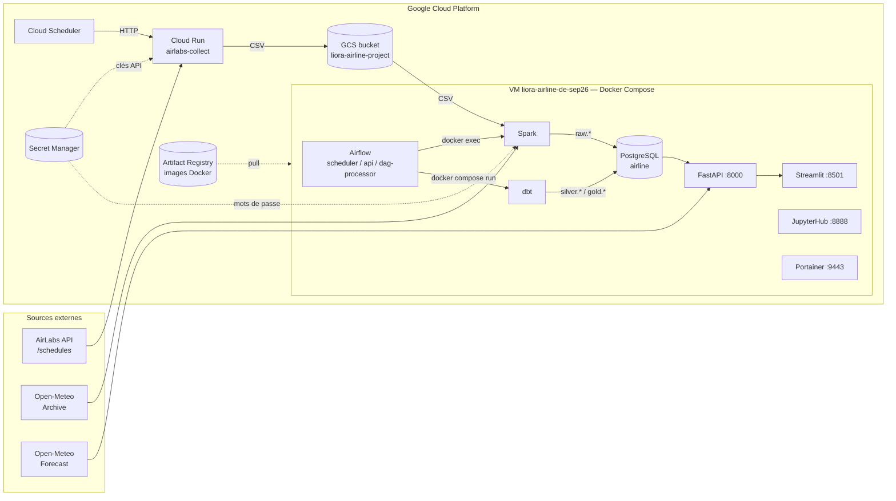
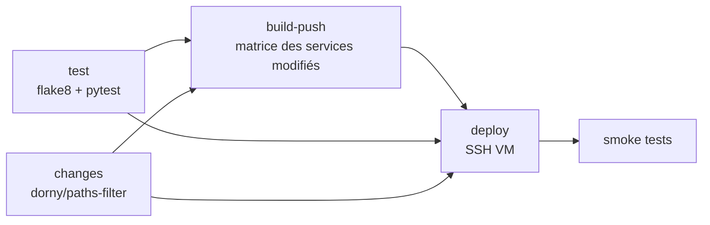

# Liora Airlines — Documentation technique

Projet Data Engineer DataScientest (promotion SEP26) : **prédiction du retard à l'arrivée des vols atterrissant à Paris** (CDG, ORY, BVA) à partir des horaires de vols AirLabs et de la météo Open-Meteo.

> Document rédigé à partir de l'état du dépôt sur la branche `master` (commit `deab282`).

---

## Sommaire

1. [Vue d'ensemble](#1-vue-densemble)
2. [Architecture](#2-architecture)
3. [Stack technique](#3-stack-technique)
4. [Organisation du dépôt](#4-organisation-du-dépôt)
5. [Infrastructure GCP](#5-infrastructure-gcp)
6. [Services Docker](#6-services-docker)
7. [Pipeline de données](#7-pipeline-de-données)
8. [Modèle de données (PostgreSQL)](#8-modèle-de-données-postgresql)
9. [Orchestration Airflow](#9-orchestration-airflow)
10. [Machine Learning](#10-machine-learning)
11. [API FastAPI](#11-api-fastapi)
12. [Frontend Streamlit](#12-frontend-streamlit)
13. [Sécurité et gestion des secrets](#13-sécurité-et-gestion-des-secrets)
14. [CI/CD](#14-cicd)
15. [Développement local et exploitation](#15-développement-local-et-exploitation)
16. [Tests](#16-tests)
17. [Points d'attention et dette technique](#17-points-dattention-et-dette-technique)

---

## 1. Vue d'ensemble

| Élément | Description |
|---|---|
| Objectif métier | Prédire si un vol arrivera avec plus de **15 minutes** de retard |
| Périmètre | Vols **atterris** (`status = landed`) à destination de **CDG, ORY, BVA** |
| Sources | [AirLabs API v9](https://airlabs.co) (horaires de vols, aéroports, compagnies) · [Open-Meteo](https://open-meteo.com) (archive météo horaire + prévisions) |
| Stockage | Google Cloud Storage (fichiers bruts) · PostgreSQL 18 (data warehouse en couches raw / silver / gold) |
| Traitements | Spark (ingestion), dbt (transformations), scikit-learn / XGBoost (ML) |
| Exposition | API FastAPI + interface Streamlit authentifiée par Google |
| Hébergement | GCP : une VM Compute Engine (stack Docker Compose) + un service Cloud Run (collecteur) |

---

## 2. Architecture



**Principe** : la collecte tourne en serverless (Cloud Run) et dépose des CSV dans GCS ; tout le reste (ingestion, transformation, entraînement, service) tourne sur une VM unique orchestrée par Airflow, avec des images construites par GitHub Actions et stockées dans Artifact Registry.

---

## 3. Stack technique

| Domaine | Technologie | Version / image |
|---|---|---|
| Base de données | PostgreSQL | `postgres:18-alpine` |
| Orchestration | Apache Airflow (SimpleAuthManager) | `apache/airflow:3.3.2` |
| Traitement distribué | Apache Spark (mode `local[*]`) | `apache/spark:4.0.1` |
| Transformations SQL | dbt-core + dbt-postgres, package `dbt_utils` 1.3.0 | `python:3.13-slim` |
| ML | scikit-learn 1.7.2, XGBoost 3.2.0, joblib | — |
| API | FastAPI 0.153, SQLAlchemy 2.0, Pydantic 2 | `python:3.13-slim` |
| Frontend | Streamlit ≥ 1.42 (OIDC natif), Plotly, streamlit-option-menu | `python:3.12-slim` |
| Notebooks | JupyterHub + PySpark (auth PAM) | `quay.io/jupyter/pyspark-notebook` |
| Collecteur | Python + functions-framework | `python:3.13-slim` (Cloud Run) |
| Administration conteneurs | Portainer CE | `portainer/portainer-ce:2.45.0` |
| IaC | Terraform (VM GCP) | provider 4.25.0 |
| CI/CD | GitHub Actions + Workload Identity Federation | — |

Connecteurs Spark embarqués dans `/opt/spark-extra-jars/` : `gcs-connector-hadoop3-latest.jar` et `postgresql-42.7.8.jar`.

---

## 4. Organisation du dépôt

```
.
├── .github/workflows/
│   ├── build-push-docker.yml     # tests → build images modifiées → déploiement VM → smoke tests
│   └── deploy-airlabs.yml        # build + déploiement du collecteur sur Cloud Run
├── docker/                       # un Dockerfile par service
│   ├── collect/                  # collecteur AirLabs (Cloud Run)
│   ├── dbt/                      # + entrypoint.sh (génère ~/.dbt/profiles.yml)
│   ├── fastapi/
│   ├── jupyter/                  # + jupyterhub_config.py, start-jupyterhub.sh
│   ├── spark/
│   ├── streamlit/                # + entrypoint.sh (génère secrets.toml)
│   ├── postgres/init/            # 01-bootstrap.sh : rôles, users, schémas, base airflow
│   ├── postgres/migrations/      # scripts SQL (non exécutés automatiquement)
│   ├── airflow/, mlflow/         # non utilisés en production (voir §17)
├── docker-compose.yaml           # stack de production (images Artifact Registry)
├── docker-compose.dev.yaml       # surcharge dev : build local + montage du code
├── infra/gcp_infra.tf            # définition de la VM GCP
├── references/data/              # airlines.json, airports.json (référentiels)
└── src/
    ├── airflow/dags/             # DAGs (montés dans Airflow via git)
    ├── airlabs_collect/          # code du collecteur Cloud Run
    ├── spark/notebooks/
    │   ├── common/               # Config (JSON + Secret Manager), init_spark()
    │   ├── ingestion/            # chargement AirLabs + collecte météo, config.json
    │   └── ml/                   # train_models.py, deploy_model.py
    ├── spark/tests/              # tests pytest
    ├── dbt/                      # projet dbt airline_platform
    ├── api/                      # FastAPI
    ├── frontend/                 # Streamlit
    └── data/                     # scripts d'exploration/collecte historiques (OPDI, météo…)
```

---

## 5. Infrastructure GCP

| Ressource | Valeur |
|---|---|
| Projet | `project-0845983d-30e1-47a7-a62` (n° `531392170598`) |
| Région / zone | `europe-west1` / `europe-west1-c` |
| VM | `liora-airline-de-sep26`, `e2-standard-2`, IPv4, Ops Agent installé (`infra/gcp_infra.tf`) |
| Bucket GCS | `liora-airline-project` |
| Artifact Registry | `europe-west1-docker.pkg.dev/project-0845983d-30e1-47a7-a62/airline/<service>` |
| Cloud Run | `liora-airline-project-sep26-airlabs-collect` |
| Secret Manager | `airlabs-api-keys`, `AIRLINEDB_PASSWORD`, `AIRLINEBUCKET_CREDENTIALS` |

Arborescence de la VM :

| Chemin | Usage |
|---|---|
| `/home/airline/repos` | clone *sparse* du dépôt (`src/airflow/dags`, `docker/postgres/init`, `docker/airflow`) + `.env` + `docker-compose.yaml` |
| `/home/airline/workspace/spark` | volume partagé Spark ↔ API (contient `models/*.joblib`) |
| `/home/airline/workspace/jupyter/notebooks` | espace de travail JupyterHub |

Arborescence du bucket :

| Préfixe | Contenu |
|---|---|
| `raw/airlabs/` | CSV fraîchement collectés (`schedule_<cdg|ory|bva>_<YYYYMMDDHH>.csv`) |
| `raw/processed/airlabs/` | CSV déjà chargés en base (archivés par Spark) |
| `raw/meteo/` | historique météo initial (scripts `src/data`) |

---

## 6. Services Docker

Défini dans [docker-compose.yaml](../docker-compose.yaml).

| Service | Conteneur | Port(s) | Rôle |
|---|---|---|---|
| `database` | `pg_container` | 5432 | PostgreSQL : bases `airline` et `airflow` |
| `spark` | `spark` | — | Conteneur « toujours allumé » (`tail -f /dev/null`) dans lequel Airflow lance des `spark-submit` |
| `jupyter` | `jupyter_pyspark` | 8888, 4040 | JupyterHub multi-utilisateurs + UI Spark |
| `airflow-init` | — | — | `airflow db migrate` (one-shot) |
| `airflow-scheduler` | `airflow_scheduler` | — | Scheduler ; a accès au socket Docker de l'hôte |
| `airflow-api-server` | `airflow_api_server` | 8080 | UI + API Airflow 3 |
| `airflow-dag-processor` | `airflow_dag_processor` | — | Parsing des DAGs |
| `portainer` | `portainer` | 127.0.0.1:9443 | Administration Docker (local uniquement, accès via tunnel SSH) |
| `dbt` | `dbt` | — | Profil `tools` : lancé à la demande (`docker compose run --rm dbt …`) |
| `api` | `airline_api` | 8000 | API FastAPI |
| `frontend` | `frontend` | 8501 | Application Streamlit |

Volumes nommés : `postgres_data`, `airflow_logs`, `portainer_data`, `mlflow_artifacts` (inutilisé).

**Pattern d'exécution** : Airflow ne contient ni Spark ni dbt. Il pilote les autres conteneurs via le socket Docker monté :
- Spark : `docker exec spark /opt/spark/bin/spark-submit --jars … <script>.py`
- dbt : `docker compose -f /home/airline/repos/docker-compose.yaml --profile tools run --rm dbt bash -c "dbt deps && dbt <cmd>"`

---

## 7. Pipeline de données

```mermaid
flowchart TB
    A[AirLabs /schedules<br/>arr_iata = CDG, ORY, BVA] -->|Cloud Run| B[GCS raw/airlabs/*.csv]
    B -->|load_airlabs_schedule_files.py| C[(raw.airlabs_schedules)]
    C --> D{collect_meteo_airlabs.py<br/>jours manquants par aéroport}
    E[Open-Meteo Archive] --> D
    D --> F[(raw.meteo_hourly)]
    G[(raw.airlabs_airports<br/>raw.airlabs_airlines)]
    C & F & G -->|dbt| H[silver.stg_*]
    H -->|dbt| I[gold.dim_* / fact_*]
    I --> J[(gold.ml_flights_features)]
    J -->|train_models.py| K[(ml.model_runs)<br/>+ models/*.joblib]
```

### 7.1 Collecte AirLabs (Cloud Run)

Code : [src/airlabs_collect/](../src/airlabs_collect/) — point d'entrée HTTP `run_http` ([main.py](../src/airlabs_collect/main.py)), déclenché par Cloud Scheduler.

1. **Sélection de la clé API** : lit la liste de clés (secret `AIRLABS_API_KEYS`, JSON `[{name, key}]`), appelle `/api/v9/ping` et retient la première clé encore valide (rotation des quotas gratuits).
2. **Lecture de la configuration** [airports.json](../src/airlabs_collect/airports.json) : une entrée par aéroport d'arrivée (`url`, `params` avec `{API_KEY}`, `pattern` du nom de fichier).
3. **Collecte paginée** (`offset`, `has_more`), 3 tentatives par page avec 10 s d'attente, 10 s entre les pages. Seuls les vols `landed` sont conservés.
4. **Écriture CSV** (union des colonnes, structures imbriquées sérialisées en JSON) dans un fichier temporaire puis **upload** vers `gs://liora-airline-project/raw/airlabs/` (variable `BUCKET_PATH`).

Le script peut aussi être lancé en CLI (`--api-keys-file`, `--airports`, `--dir`, `--bucket-path`, `--google-credentials`).

### 7.2 Ingestion des horaires (Spark)

Script : [load_airlabs_schedule_files.py](../src/spark/notebooks/ingestion/load_airlabs_schedule_files.py) — config : [config.json](../src/spark/notebooks/ingestion/config.json).

1. Charge `config.json` puis les secrets `AIRLINEDB_PASSWORD` / `AIRLINEBUCKET_CREDENTIALS` depuis Secret Manager (`Config.get_secrets()`).
2. Lit tous les CSV de `raw/airlabs/` (`gs://…`), ajoute la colonne `source_file`.
3. Nettoyage : lignes vides, filtre `landed`, colonnes clés non nulles, typage (timestamps, entiers), dédoublonnage sur `(airline_icao, flight_number, dep_iata, dep_time, arr_iata)`.
4. Écrit dans une table de staging unique `temp.staging_airlabs_schedule_<uuid>` (JDBC).
5. `INSERT … SELECT DISTINCT … ON CONFLICT DO NOTHING` dans `raw.airlabs_schedules` (idempotent), puis supprime la staging.
6. Déplace les fichiers traités vers `raw/processed/airlabs/`.

### 7.3 Collecte météo (Spark + Open-Meteo)

Script : [collect_meteo_airlabs.py](../src/spark/notebooks/ingestion/collect_meteo_airlabs.py).

1. Calcule en SQL, pour chaque aéroport (départ **et** arrivée), les **jours avec vols** qui n'ont pas encore leurs **24 heures** de météo dans `raw.meteo_hourly`. L'ICAO est pris dans le vol ou déduit de l'IATA via `raw.airlabs_airports` (les codes erronés `OPRN` et `UGGG` sont exclus).
2. Ne demande que les jours ≤ *aujourd'hui − `METEO_ARCHIVE_DELAY_DAYS`* (5 par défaut, délai de publication de l'archive).
3. Un appel par aéroport sur la plage de jours manquants ; arrêt propre au premier **HTTP 429** (la prochaine exécution reprend).
4. Staging `temp.staging_meteo_hourly_<uuid>` puis `INSERT … ON CONFLICT (icao, time) DO NOTHING`.

Variables horaires collectées : `temperature_2m`, `dew_point_2m`, `relative_humidity_2m`, `pressure_msl`, `cloud_cover` (+ `_low/_mid/_high`), `wind_speed_10m`, `wind_direction_10m`, `wind_gusts_10m`, `precipitation`, `rain`, `snowfall`, `weather_code`.

### 7.4 Transformations dbt

Projet : [src/dbt/](../src/dbt/) (`airline_platform`, profil `dataplatform`). La macro `generate_schema_name` force l'utilisation du schéma déclaré tel quel (`silver`, `gold`, `raw`) sans préfixe.

**Seeds** (schéma `raw`) :
- `airport_corrections.csv` : codes ICAO à écarter (`OPRN→OPIS`, `UGGG→UGTB`).
- `weather_codes.csv` : libellés des codes météo WMO 4677.

**Silver** (tables, avec index en `post_hook`) :

| Modèle | Source | Rôle |
|---|---|---|
| `stg_airports` | `raw.airlabs_airports` | Dédoublonnage par ICAO, clé `airport_id = md5(icao_code)` |
| `stg_airlines` | `raw.airlabs_airlines` | Dédoublonnage par ICAO, clé `airline_id` |
| `stg_schedules` | `raw.airlabs_schedules` | Vol réel (une ligne par vol daté) : harmonisation des heures d'arrivée en UTC selon l'origine du fichier, dédoublonnage des *code-shares*, résolution des aéroports par ICAO (fallback IATA), `delayed = arr_delayed` |
| `stg_flights` | `raw.airlabs_schedules` | Vol « catalogue » (ligne régulière) : agrégat par vol / aéroports / heures / jour de semaine, avec nombre d'`occurences` |
| `stg_weather_hourly` | `raw.meteo_hourly` | Ajoute `airport_id` et l'encodage cyclique du vent (`sin`/`cos`) |

**Gold** :

| Modèle | Matérialisation | Rôle |
|---|---|---|
| `dim_airports`, `dim_airlines`, `dim_flights` | vues | Exposition des tables silver |
| `dim_weather_codes` | table | Code, libellé, catégorie (`code/10`) et sous-catégorie |
| `fact_flights` | table | Un vol réalisé : heures d'arrivée prévue/réelle UTC, `arr_hour` (tronquée à l'heure), `dow` et `arr_hour_local` (Europe/Paris), `arr_delay_min`, **`delay = arr_delay_min > 15`** |
| `fact_weather_hourly` | table | Météo horaire limitée à la période couverte par AirLabs |
| `ml_flights_features` | table | Jeu d'entraînement : `fact_flights` ⨝ dimensions ⨝ météo **à l'aéroport d'arrivée, à l'heure d'arrivée prévue** |

**Tests dbt** (`schema.yml`) : `unique` / `not_null` sur toutes les clés, `relationships` (`fact_flights → dim_airports / dim_airlines`, `fact_weather_hourly → dim_weather_codes`), `unique_combination_of_columns (icao, time)` sur la météo, `not_null` sur la cible `delay`.

---

## 8. Modèle de données (PostgreSQL)

Base **`airline`** :

| Schéma | Alimenté par | Contenu |
|---|---|---|
| `raw` | Spark, seeds dbt, scripts de chargement initiaux | `airlabs_schedules`, `airlabs_airports`, `airlabs_airlines`, `meteo_hourly`, `airport_corrections`, `weather_codes` |
| `temp` | Spark | Tables de staging éphémères (supprimées en fin de job) |
| `silver` | dbt | `stg_*` |
| `gold` | dbt | Dimensions, faits, `ml_flights_features` |
| `ml` | `train_models.py` | `model_runs` (historique des modèles) |

Base **`airflow`** : métadonnées Airflow (propriétaire `airflow`).

### Table `raw.airlabs_schedules` (principale)

Clé technique `id` (identity), contrainte d'unicité `(airline_icao, flight_number, dep_iata, dep_time, arr_iata)`. Colonnes : `airline_icao`, `flight_icao`, `flight_number`, `dep_iata`, `dep_icao`, `dep_time`, `dep_estimated`, `dep_actual`, `arr_iata`, `arr_icao`, `arr_time`, `arr_estimated`, `arr_actual`, `cs_flight_iata`, `status`, `duration`, `dep_delayed`, `arr_delayed`, `*_utc`, `source_file`.

### Table `ml.model_runs`

| Colonne | Description |
|---|---|
| `model_name` (PK) | `<type>_<YYYYMMDD_HHMM>` (ex. `xgb_20261027_1453`) |
| `model_type` | `rf` ou `xgb` |
| `trained_at` | horodatage UTC |
| `train_rows`, `test_rows`, `train_days`, `test_days`, `train_delay_rate`, `test_delay_rate` | description du split |
| `tp`, `fp`, `tn`, `fn`, `precision`, `recall`, `f1`, `roc_auc` | scores sur le jeu de test |
| `training_seconds`, `model_path` | durée et fichier `.joblib` |
| `deployed_at`, `online` | date du dernier déploiement ; **un seul** modèle `online = true` |

---

## 9. Orchestration Airflow

DAGs dans [src/airflow/dags/](../src/airflow/dags/), montés en volume (déployés par `git` sur la VM, pas d'image à reconstruire). Horaires en UTC.

| DAG | Planification | Tâches |
|---|---|---|
| `ingest_airlabs_schedule` | `30 8,14,20 * * *` | `run_airlabs_ingestion` (Spark) → `run_meteo_collect` (Spark) |
| `airline_pipeline` | `30 8,14 * * *` | `dbt_seed` → `dbt_run` → `dbt_test` → `dbt_docs` (les étapes suivantes tournent même en cas d'échec : `ALL_DONE`) |
| `test` | manuel | `sleep 5 && echo hello` (vérification de l'installation) |

Authentification : `SimpleAuthManager`, utilisateurs `herve` et `pascal` (admin), mots de passe dans `docker/airflow/passwords.json` (généré par la CI depuis le secret `AIRFLOW_PASSWORDS`).

---

## 10. Machine Learning

### 10.1 Entraînement — [train_models.py](../src/spark/notebooks/ml/train_models.py)

| Étape | Détail |
|---|---|
| Données | `gold.ml_flights_features`, vols sans météo exclus |
| Cible | `delay` (retard à l'arrivée > 15 min) |
| Variables catégorielles | `airline_icao`, `adep`, `ades` → `OneHotEncoder(handle_unknown="ignore")` |
| Variables numériques | `dow`, `arr_hour_local`, 15 variables météo à l'arrivée (température, écart température/point de rosée, humidité, pression, nébulosités, vent sin/cos, rafales, précipitations, neige, code météo) |
| Split | `GroupShuffleSplit` 80/20 **par jour entier** (aucun jour partagé train/test, évite la fuite météo) |
| Modèles | `RandomForestClassifier` (100 arbres, `class_weight="balanced"`) et `XGBClassifier` (300 arbres, profondeur 6, lr 0.1, `scale_pos_weight` = ratio de classes) |
| Évaluation | Matrice de confusion, précision, rappel, F1 (classe retard), ROC AUC, seuil 0,5 |
| Artefacts | Pipeline complet (prétraitement + modèle) sérialisé en `/app/workspace/models/<model_name>.joblib` ; une ligne par modèle dans `ml.model_runs` |

Lancement (manuel, pas de DAG) :

```bash
docker exec spark /opt/spark/bin/spark-submit /app/src/notebooks/ml/train_models.py
```

### 10.2 Déploiement d'un modèle

Deux méthodes équivalentes :

- **Depuis l'interface** Streamlit (onglet *Modèles*) → `POST /models/{model_name}/deploy` : copie atomique (`.tmp` + `os.replace`) vers `model.joblib`, mise à jour de `online` / `deployed_at`, **rechargement à chaud** dans l'API.
- **En ligne de commande** :
  ```bash
  docker exec spark /opt/spark/bin/spark-submit /app/src/notebooks/ml/deploy_model.py xgb_20261027_1453
  ```
  puis redémarrer l'API (`docker compose restart api`).

Le répertoire `/home/airline/workspace/spark` est monté à la fois dans `spark` et `api` (`/app/workspace`), ce qui permet le partage des fichiers modèles.

### 10.3 Inférence

[ml_model.py](../src/api/ml_model.py) + [flight_predictor.py](../src/api/flight_predictor.py) :
1. Pour chaque vol, récupère la **prévision** Open-Meteo à l'aéroport d'arrivée pour l'heure d'arrivée (heure de Paris convertie en UTC).
2. Reconstruit exactement les colonnes de `gold.ml_flights_features` (`build_features`).
3. `predict` / `predict_proba` → `is_delayed = proba ≥ 0,5`, `delay_probability`.

---

## 11. API FastAPI

Code : [src/api/](../src/api/). Documentation interactive : `http://<vm>:8000/docs`.

**Authentification** : toutes les routes exigent l'en-tête `X-API-Key` (comparaison à temps constant, `secrets.compare_digest`). Valeur : variable `API_KEY` (secret `FASTAPI_KEY`).

| Méthode | Route | Description |
|---|---|---|
| `POST` | `/predict` | Prédiction pour un vol (`{"flight": Flight}`) → `PredictionOutput` |
| `POST` | `/predict-batch` | Prédiction pour une liste de vols |
| `POST` | `/flights` | Recherche de vols catalogue (`gold.dim_flights`) : compagnie (nom ou codes ICAO), origine, destination, date, plage horaire, pagination |
| `GET` | `/airports` | Aéroports (`search`, `country`) |
| `GET` | `/airlines` | Compagnies (`search`) |
| `GET` | `/stats` | Statistiques agrégées (voir §17) |
| `GET` | `/models` | Liste des modèles de `ml.model_runs` |
| `POST` | `/models/{model_name}/deploy` | Déploie et recharge un modèle |

Configuration ([config.py](../src/api/config.py)) : `API_KEY`, `PG_USER`, `PG_PASSWORD`, `PG_HOST`, `PG_PORT`, `PG_DB`, `MODEL_PATH` (défaut `/app/workspace/models/model.joblib`). Pool SQLAlchemy : 5 connexions + 10 en débordement, `pool_pre_ping`.

Le modèle est chargé au démarrage (`lifespan`) ; si le fichier est absent, l'API démarre quand même et renvoie **503** sur les prédictions.

---

## 12. Frontend Streamlit

Code : [src/frontend/](../src/frontend/), point d'entrée [app.py](../src/frontend/app.py).

- **Authentification** : OIDC Google natif de Streamlit (`st.login`). Le fichier `~/.streamlit/secrets.toml` est généré au démarrage par [entrypoint.sh](../docker/streamlit/entrypoint.sh) à partir de `GOOGLE_CLIENT_ID`, `GOOGLE_CLIENT_SECRET`, `COOKIE_SECRET`. Un mode démo (bypass) est contrôlé par `ALLOW_DEV_BYPASS_GOOGLE_AUTH`.
- **Client API** : [api_client.py](../src/frontend/api_client.py) (en-tête `X-API-Key`, cache Streamlit des référentiels).

| Menu | Vue | Fonction |
|---|---|---|
| Prédiction un vol | `predict_single.py` | Choix compagnie / origine / destination parisienne / date / heure → recherche `/flights` puis prédiction `/predict` |
| Statistiques | `statistics.py` | Courbes de réponse du modèle et données agrégées |
| Références | `references.py` | Tables Airlines / Airports / Flights |
| Modèles | `models.py` | Liste des modèles et scores, déploiement avec boîte de confirmation |

---

## 13. Sécurité et gestion des secrets

### Rôles PostgreSQL ([01-bootstrap.sh](../docker/postgres/init/01-bootstrap.sh))

Exécuté **uniquement au premier démarrage** (volume `postgres_data` vide).

| Rôle | Usage |
|---|---|
| `admin` | super-utilisateur (`POSTGRES_USER`) |
| `batch` | compte technique Spark / dbt / API |
| `herve`, `pascal` | comptes nominatifs des développeurs |
| `airflow` | propriétaire de la base `airflow` |
| `airline_rw` | rôle groupe (lecture/écriture `raw`, `silver`, `gold`) attribué à tous ; privilèges par défaut sur les futurs objets |

### Secrets

| Où | Secrets |
|---|---|
| GitHub Actions | `GCP_WORKLOAD_IDENTITY_PROVIDER`, `GCP_DEPLOY_SERVICE_ACCOUNT`, `GCP_VM_HOST`, `GCP_VM_USER`, `GCP_VM_SSH_KEY`, `PG_ADMIN_PASSWORD`, `DBT_BATCH_PASSWORD`, `HERVE_PASSWORD`, `PASCAL_PASSWORD`, `AIRFLOW_PASSWORD`, `AIRFLOW_DB_CONN`, `AIRFLOW_JWT_SECRET`, `AIRFLOW_PASSWORDS`, `JUPYTER_PASSWORD_HERVE`, `JUPYTER_PASSWORD_PASCAL`, `FASTAPI_KEY`, `GOOGLE_CLIENT_ID`, `GOOGLE_CLIENT_SECRET`, `COOKIE_SECRET` |
| GCP Secret Manager | `airlabs-api-keys` (Cloud Run), `AIRLINEDB_PASSWORD`, `AIRLINEBUCKET_CREDENTIALS` (jobs Spark) |
| VM | `/home/airline/repos/.env` et `docker/airflow/passwords.json`, **réécrits à chaque déploiement** par la CI |

Bonnes pratiques en place : authentification GCP sans clé (Workload Identity Federation), `.dockerignore` excluant `.env` / `passwords.json` / `.git`, Portainer exposé uniquement en local, `.gitattributes` forçant les fins de ligne LF pour les scripts shell.

---

## 14. CI/CD

### 14.1 `build-push-docker.yml` — stack de la VM

Déclenchement : push sur `master` (chemins `docker/**`, `src/api/**`, `src/frontend/**`, `src/spark/**`, `src/dbt/**`), PR vers `master`, ou manuel.



1. **test** : Python 3.10, `flake8` bloquant sur les erreurs de syntaxe / noms indéfinis de `src/spark`, `pytest src/spark/tests`.
2. **changes** : détermine quels services (`api`, `frontend`, `jupyter`, `spark`, `dbt`) ont changé ; tous en déclenchement manuel.
3. **build-push** : build Buildx (cache GHA par service), push des tags `:<sha>` et `:latest`.
4. **deploy** (pas sur les PR, sérialisé via `concurrency: deploy-vm`) : écrit `.env` et `passwords.json` sur la VM par SSH, `git sparse-checkout` + checkout de la branche, `docker compose pull` puis `up -d`, nettoyage des images.
5. **smoke tests** : état `running` des 9 conteneurs, santé HTTP (FastAPI `/docs`, Streamlit `/_stcore/health`, JupyterHub `/hub/health`, Airflow `/api/v2/monitor/health`, Portainer), `pg_isready`, présence des jars et scripts Spark, `dbt debug` lancé depuis Airflow, erreurs d'import des DAGs (informatif).

### 14.2 `deploy-airlabs.yml` — collecteur Cloud Run

Déclenchement : changements dans `src/airlabs_collect/**` ou `docker/collect/**`. Build de l'image `airlabs-collect:<sha>` puis `deploy-cloudrun` avec injection du secret `AIRLABS_API_KEYS=airlabs-api-keys:latest`.

---

## 15. Développement local et exploitation

### Lancer la stack en local (build des images + code monté)

Pré-requis : un fichier `.env` à la racine contenant les variables listées au §13 (`PG_ADMIN_PASSWORD`, `DBT_BATCH_PASSWORD`, `FASTAPI_KEY`, …) et `docker/airflow/passwords.json`.

```bash
docker compose -f docker-compose.yaml -f docker-compose.dev.yaml up --build
```

> Les services `spark`, `jupyter` et `api` montent des chemins `/home/airline/workspace/...` propres à la VM : à adapter sous Windows/macOS.

### Débogage des jobs Spark sous Windows

Voir [src/spark/notebooks/README.md](../src/spark/notebooks/README.md) : JDK 17, `JAVA_HOME`, paquets Python, `gcloud auth application-default login`. Hors Docker (`RUN_ENV` ≠ `docker`), les scripts se connectent à PostgreSQL sur `localhost` (tunnel SSH vers la VM).

### Commandes utiles sur la VM

```bash
cd /home/airline/repos && docker compose ps
```

```bash
docker compose --profile tools run --rm dbt bash -c "dbt deps && dbt run --select gold"
```

```bash
docker exec spark /opt/spark/bin/spark-submit --jars /opt/spark-extra-jars/gcs-connector.jar,/opt/spark-extra-jars/postgresql.jar /app/src/notebooks/ingestion/load_airlabs_schedule_files.py
```

```bash
docker exec airflow_scheduler airflow dags trigger airline_pipeline
```

### Accès aux interfaces

| Interface | URL |
|---|---|
| Streamlit | `http://<vm>:8501` |
| FastAPI (Swagger) | `http://<vm>:8000/docs` |
| Airflow | `http://<vm>:8080` |
| JupyterHub | `http://<vm>:8888` |
| Portainer | `ssh -L 9443:127.0.0.1:9443 <user>@<vm>` puis `https://localhost:9443` |

---

## 16. Tests

| Niveau | Outil | Contenu |
|---|---|---|
| Unitaires | pytest (`src/spark/tests`) | `Config` (chargement, accès `[]`/attribut, secrets mockés) et `init_spark` (variables d'environnement, configuration Hadoop GCS) |
| Qualité | flake8 | erreurs bloquantes (E9, F63, F7, F82) + rapport de complexité |
| Données | dbt test | unicité, non-nullité, intégrité référentielle |
| Déploiement | smoke tests CI | conteneurs, endpoints de santé, connexion dbt |

```bash
cd src && pytest spark/tests
```

---

## 17. Points d'attention et dette technique

Relevés pendant la rédaction de cette documentation ; à traiter ou à garder en tête.

### Bugs probables

| Emplacement | Constat |
|---|---|
| [api/main.py](../src/api/main.py) `/stats` | Interroge `silver.flights` et des colonnes (`departure_delay`, `cancelled`…) qui n'existent pas dans le modèle dbt → erreur 500 |
| [api/main.py](../src/api/main.py) `/flights` | `HTTPException("…")` sans `status_code` et `print(e.message)` lèvent des `TypeError`/`AttributeError` au lieu de renvoyer l'erreur métier |
| [api/main.py](../src/api/main.py) `/flights` | Le paramètre `airline_name` est entouré d'apostrophes (`"'%x%'"`) : le `ILIKE` ne trouve rien |
| [api/main.py](../src/api/main.py) `/flights` | `dow = (weekday() + 1) % 8` donne 7 pour dimanche alors que `EXTRACT(DOW)` de PostgreSQL donne 0 → aucun vol trouvé le dimanche |
| [api/ml_model.py](../src/api/ml_model.py) | `predicted_delay_minutes` contient la classe prédite (0/1), pas des minutes |
| [airlabs_collect/airlabs.py](../src/airlabs_collect/airlabs.py) | `run()` plante (`None[1]`) si aucune clé n'est disponible ; `main()` utilise `args.google_creds` au lieu de `args.google_cred` |
| [frontend/views/predict_batch.py](../src/frontend/views/predict_batch.py), `statistics.py` | Utilisent l'ancien format de vol (`airline_code`, `distance`…) incompatible avec le schéma `Flight` actuel ; l'entrée « Prédiction plusieurs vols » n'est plus dans le menu |
| [docker-compose.yaml](../docker-compose.yaml) | Healthcheck PostgreSQL sur `-d airflow` alors que la base principale est `airline` (fonctionne car `pg_isready` teste le serveur) |

### Orchestration

- `airline_pipeline` (dbt) et `ingest_airlabs_schedule` partent tous deux à 08:30 et 14:30 UTC sans dépendance : dbt peut transformer des données pas encore chargées. Piste : décaler dbt ou le déclencher via un `Asset`/`TriggerDagRunOperator` à la fin de l'ingestion.
- L'entraînement des modèles n'est pas orchestré (lancement manuel).

### Sécurité

- `ALLOW_DEV_BYPASS_GOOGLE_AUTH` vaut `true` par défaut : le bouton « Mode Démo Dev » permet d'entrer sans compte Google si la variable n'est pas définie à `false` en production.
- `redirect_uri` Streamlit codé en dur sur `http://localhost:8501`.
- PostgreSQL (5432), Airflow, JupyterHub, API et Streamlit sont publiés sur toutes les interfaces : la protection repose sur les règles de pare-feu GCP. CORS `*` sur l'API.
- `.env` écrit en `chmod 666` sur la VM.

### Code mort / à nettoyer

- `README.md` encore issu du template *cookiecutter* (« movie_recommandation »).
- `docker/airflow/Dockerfile` (référence `src/spark/jobs` inexistant) et `docker/mlflow/` non utilisés ; service MLflow commenté.
- `docker/postgres/migrations/V1__create_airlabs_schedules.sql` incomplet (`CREATE TABLE raw.airlines ()` vide) et non exécuté automatiquement ; la table `raw.airlabs_schedules` réelle contient aussi `dep_icao`, `arr_icao` et les colonnes `*_utc`.
- `src/dbt/profile.yml` non utilisé (le profil est généré par `entrypoint.sh`).
- `src/data/collect_airlabs.py` duplique `src/airlabs_collect/airlabs.py` ; `src/models/*.py`, `src/features`, `src/visualization` vides (template).
- `deploy-airlabs.yml` se déclenche encore sur la branche `change-docker-architecture` (« à retirer après la fusion »).
- Socket Docker monté deux fois dans `airflow-scheduler`.
- Images `jupyter` et jars GCS (`gcs-connector-hadoop3-latest`) non épinglés en version : builds non reproductibles.
